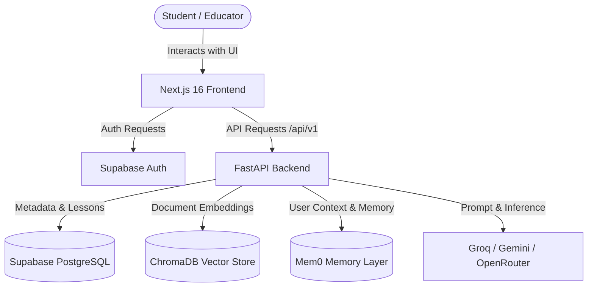

# QuizCraft AI 🎓

QuizCraft AI is an intelligent, full-stack educational platform that transforms study materials into personalized quizzes, flashcards, and notes. Built with **Next.js 16**, **FastAPI**, **LangChain**, and **ChromaDB**, it features an adaptive learning engine, spaced repetition (SM-2), an AI personal tutor with persistent memory (Mem0), and Retrieval-Augmented Generation (RAG) for interactive document chat.

[](https://opensource.org/licenses/MIT)
[](https://nextjs.org/)
[](https://react.dev/)
[](https://tailwindcss.com/)
[](https://fastapi.tiangolo.com/)
[](https://supabase.com/)
[](https://www.trychroma.com/)
[](https://www.langchain.com/)

---

## 🎯 Problem Statement & Goals

Traditional study platforms offer static, one-size-fits-all questionnaires that fail to adapt to a student's individual learning curve and retention rate.

**QuizCraft AI solves this by:**
- Generating multi-tiered learning material directly from uploaded textbooks, lecture notes, and documents.
- Implementing proven cognitive science techniques: Bloom's taxonomy for assessment levels and the SuperMemo-2 (SM-2) spaced repetition algorithm for retention.
- Maintaining an empathetic AI tutor equipped with long-term memory to coach students across sessions.

---

## ✨ Key Features

### 🤖 AI-Powered Content Generation
- **Dynamic Quiz Generation**: Automatically generates customized quizzes from uploaded files or pasted text using Groq, Google Gemini, or OpenRouter.
- **Multiple Question Types**: Multiple choice, true/false, short answer, fill-in-the-blanks, and matching.
- **Bloom's Taxonomy Framework**: Questions tagged across cognitive levels (*Remember, Understand, Apply, Analyze, Evaluate, Create*).
- **Automated Flashcards & Study Notes**: Generates markdown notes and flashcard decks ready for review.

### 🧠 Adaptive Learning & Spaced Repetition
- **SuperMemo 2 (SM-2) Algorithm**: Calculates card review intervals based on user-rated recall quality (0–5).
- **Adaptive Difficulty**: Dynamically suggests challenge levels based on past quiz attempts.
- **Weak-Spot Detection**: Identifies concepts where the user frequently makes mistakes to recommend focused study.

### 💬 AI Personal Tutor (Mem0 + LLM)
- **Persistent Memory**: Uses Mem0 to retain student strengths, weaknesses, and learning styles across sessions.
- **Streaming Responses**: Real-time interactive guidance with empathetic support for study anxiety.
- **Learning Profile**: Synthesizes academic progress and personalized improvement tips.

### 📚 RAG Document Chat (Chat with PDF)
- **Document Ingestion**: Supports `.pdf`, `.docx`, and `.txt` files with text extraction and chunking.
- **Semantic Vector Search**: Embeds document chunks using `sentence-transformers/all-MiniLM-L6-v2` and persists them in ChromaDB.
- **Grounded Q&A**: Answers queries citing specific context from the user's uploaded materials.

### 📁 Workspace & Lesson Management
- **Hierarchical Folders**: Organize lessons, quizzes, and decks into structured folders.
- **Supabase Authentication**: Secure user registration, session management, and Row-Level Security (RLS).

---

## 🛠️ Technology Stack

### Frontend
- **Framework**: Next.js 16 (App Router) with React 19
- **Styling**: Tailwind CSS 4
- **UI Primitives**: Radix UI (Dialog, Dropdown, Select, Tabs, Switch, Progress)
- **State Management**: Zustand
- **Animations**: Framer Motion
- **Document Viewing**: PDF.js & react-pdf
- **Markdown**: React-Markdown with GFM support
- **Icons & Toast**: Lucide React, React Hot Toast

### Backend
- **Framework**: FastAPI (Python 3.9+)
- **ASGI Server**: Uvicorn
- **Database & Auth**: Supabase (PostgreSQL with Row-Level Security)
- **Vector Database**: ChromaDB
- **Embeddings**: Sentence Transformers (`all-MiniLM-L6-v2`)
- **LLM Orchestration**: LangChain & LangChain Community
- **Memory Layer**: Mem0 (`mem0ai`)
- **Supported LLM Providers**: Groq (LLaMA 3), Google Gemini 2.5 Flash, OpenRouter
- **Document Parsing**: PyPDF2, pypdf, python-docx, mammoth
- **Logging**: Loguru

---

## 🏛️ System Architecture & Workflow



1. **Ingestion**: User uploads a document $\rightarrow$ text is extracted, chunked, and embedded into ChromaDB.
2. **Generation**: FastAPI triggers LangChain pipelines to generate quizzes, flashcards, or study summaries.
3. **Tutoring & Chat**: Queries retrieve semantic chunks from ChromaDB and user history from Mem0 before streaming answers from the LLM.

---

## 🚀 Getting Started

### Prerequisites
- **Node.js**: v18 or higher & npm
- **Python**: v3.9 or higher
- **Supabase Account**: Project URL and Anon/Service-Role API keys ([supabase.com](https://supabase.com))
- **LLM Provider API Key**: Groq, Google Gemini, or OpenRouter
- **Mem0 API Key**: (Optional, for tutor memory persistence)

---

### Installation & Local Setup

#### 1. Clone the Repository
```bash
git clone https://github.com/saurabhrdj50/quizcraft-ai.git
cd quizcraft-ai
```

#### 2. Backend Setup
```bash
cd backend

# Create and activate virtual environment
python3 -m venv venv
source venv/bin/activate  # On Windows: venv\Scripts\activate

# Install dependencies
pip install -r requirements/base.txt

# Configure environment variables
cp env.example .env
# Edit .env with your credentials

# Run FastAPI server
uvicorn app.main:app --reload --port 8000
```
- API Documentation available at: `http://localhost:8000/docs`

#### 3. Frontend Setup
```bash
cd ../frontend

# Install dependencies
npm install

# Configure environment variables
cp .env.example .env.local
# Edit .env.local with your backend and Supabase URLs

# Run Next.js development server
npm run dev
```
- Open [http://localhost:3000](http://localhost:3000) in your browser.

---

## ⚙️ Environment Variables Reference

### Backend (`backend/.env`)
| Variable | Description | Example / Default |
|---|---|---|
| `APP_NAME` | Name of application | `QuizCraft AI` |
| `DEBUG` | Enable debug mode | `false` |
| `API_V1_PREFIX` | Base path for API endpoints | `/api/v1` |
| `SECRET_KEY` | Secret key for JWT encryption | `your-secret-key-here` |
| `SUPABASE_URL` | Supabase project URL | `https://your-project.supabase.co` |
| `SUPABASE_KEY` | Supabase public anon key | `your-supabase-anon-key` |
| `SUPABASE_SERVICE_KEY` | Supabase service-role key | `your-supabase-service-key` |
| `LLM_PROVIDER` | Active LLM provider (`groq`, `google`, `openrouter`) | `groq` |
| `LLM_API_KEY` | API key corresponding to provider | `your-llm-api-key` |
| `LLM_MODEL` | Target model identifier | `llama3-8b-8192` |
| `VECTOR_DB_PATH` | Storage path for ChromaDB files | `./data/chromadb` |
| `EMBEDDING_MODEL` | HuggingFace embedding model | `sentence-transformers/all-MiniLM-L6-v2` |
| `BACKEND_CORS_ORIGINS` | Allowed origins for CORS | `["http://localhost:3000"]` |

### Frontend (`frontend/.env.local`)
| Variable | Description | Example / Default |
|---|---|---|
| `NEXT_PUBLIC_API_URL` | Backend server URL | `http://localhost:8000` |
| `NEXT_PUBLIC_API_VERSION` | Backend API version prefix | `v1` |
| `NEXT_PUBLIC_SUPABASE_URL` | Supabase project URL | `https://your-project.supabase.co` |
| `NEXT_PUBLIC_SUPABASE_ANON_KEY` | Supabase public anon key | `your-supabase-anon-key` |

---

## 🧪 Testing & Code Quality

- **Frontend Linting**:
  ```bash
  cd frontend
  npm run lint
  ```
- **Frontend Production Build Check**:
  ```bash
  cd frontend
  npm run build
  ```
- **Backend Syntax & Compilation**:
  ```bash
  python3 -m compileall app
  ```
- **Backend Unit Tests** (requires installing `requirements/dev.txt`):
  ```bash
  cd backend
  pytest
  ```

---

## 🐳 Docker Support

To run the backend with Docker:
```bash
cd backend
docker build -t quizcraft-backend .
docker run -p 8000:8000 --env-file .env quizcraft-backend
```

---

## 👨‍💻 Maintainer

**Saurabh Gupta**
- GitHub: [@saurabhrdj50](https://github.com/saurabhrdj50)
- LinkedIn: [saurabh-gupta](https://www.linkedin.com/in/saurabh-gupta-9470372b6/)
- Repository: [quizcraft-ai](https://github.com/saurabhrdj50/quizcraft-ai)

---

## 🙏 Acknowledgements

- **Vikas Gupta** for initial platform concept and core architecture.
- [FastAPI](https://fastapi.tiangolo.com/) & [Next.js](https://nextjs.org/) open-source teams.
- [LangChain](https://www.langchain.com/) and [ChromaDB](https://www.trychroma.com/) for document parsing and vector retrieval infrastructure.
- [Mem0](https://mem0.ai/) for intelligent context memory layer.
